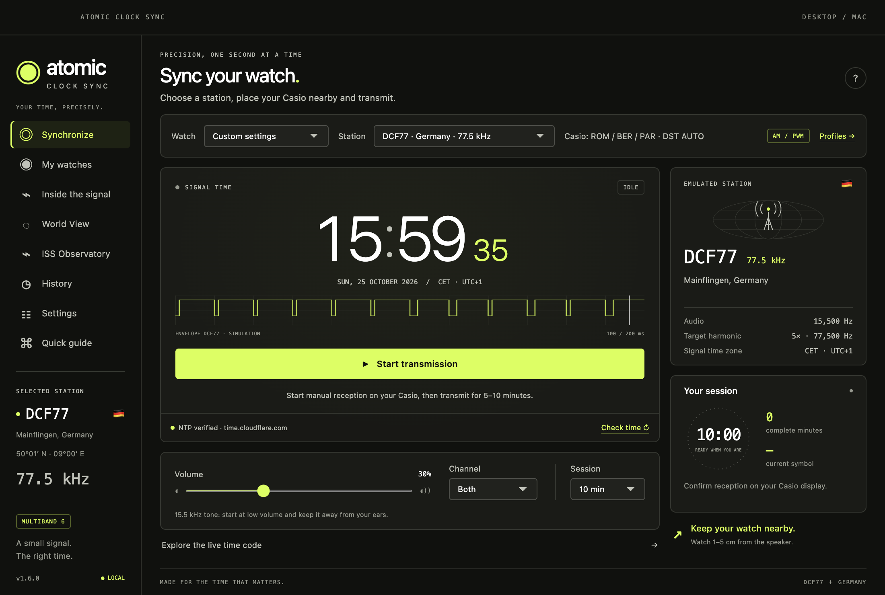
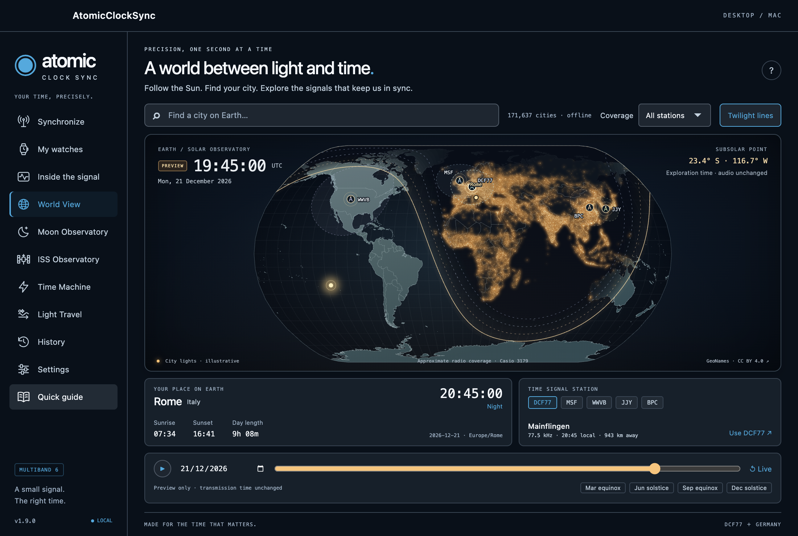
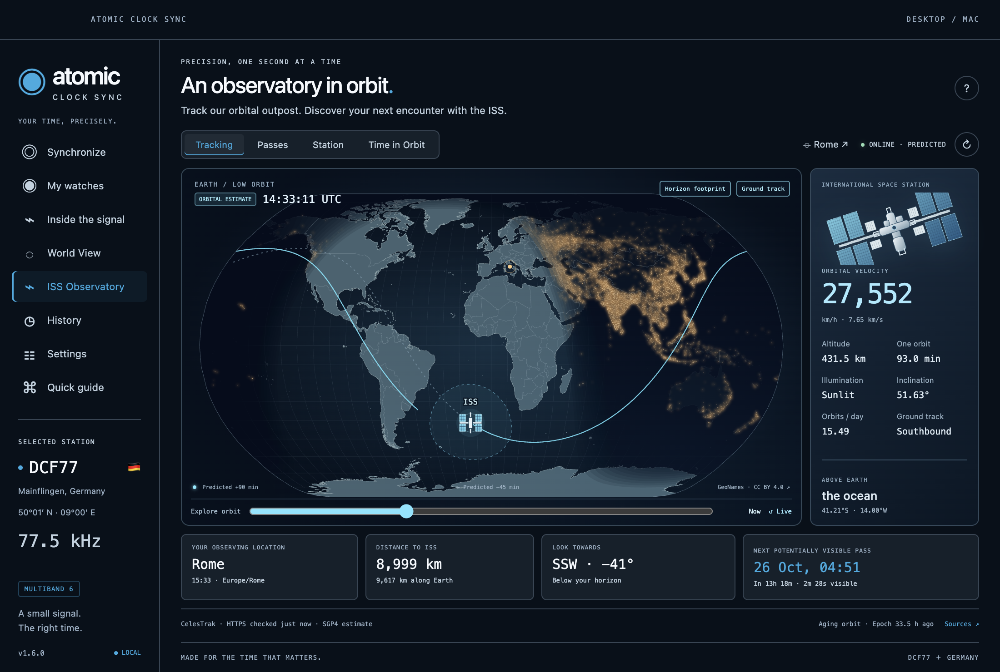
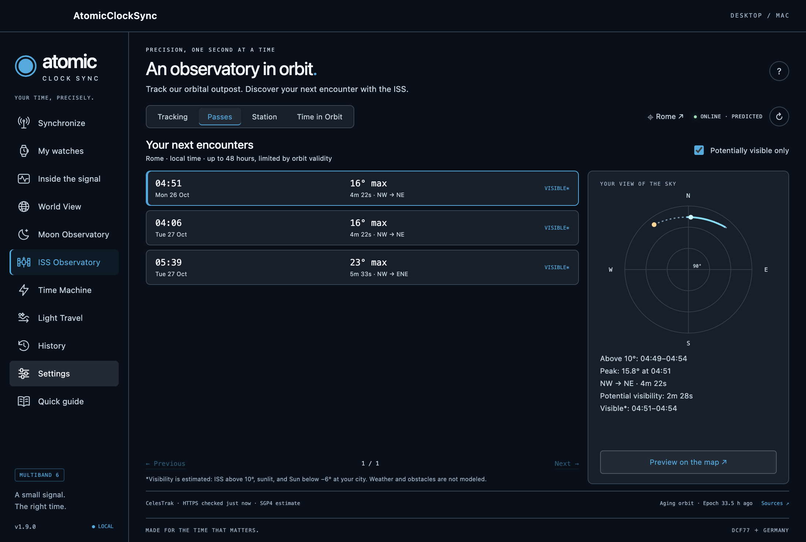
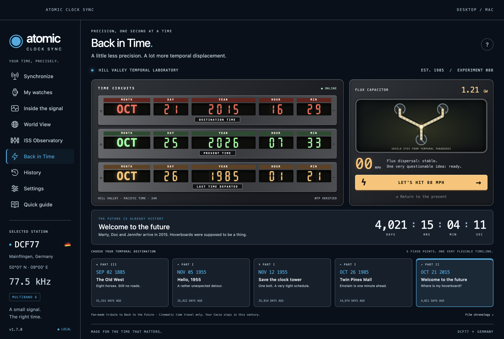
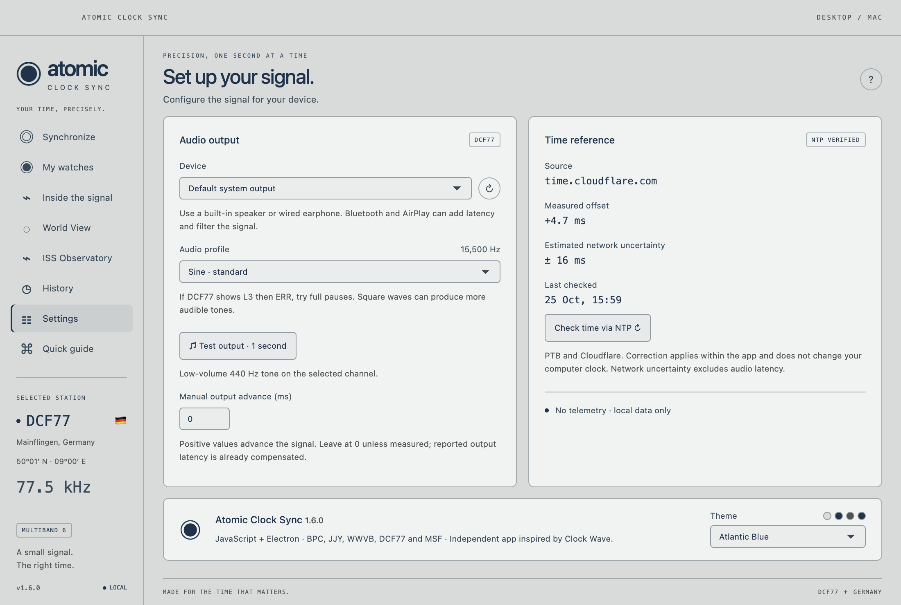

# Atomic Clock Sync

Sync Casio Multiband 6 watches with simulated time signals through your speakers. Built with **JavaScript and Electron** for macOS and Windows.



Atomic Clock Sync generates the time codes used by DCF77, MSF, WWVB, JJY and BPC. Choose a station, check the time, place your watch near a speaker or wired earphone, and start manual reception on the watch.

The interface, source files and documentation are in English. Read the [full user guide](docs/USAGE.en.md) for setup, troubleshooting and protocol details.

## Features

- **Back in Time:** a playful time-circuit dashboard inspired by Back to the Future, with five movie destinations, live elapsed-time counters and an animated 88 mph trip.
- **ISS Orbital Observatory:** live orbital estimates, offline prediction cache, local sighting passes, a sky plot and an educational time-dilation explorer.
- **World View:** an offline vector Earth with astronomical day/night, amber city lights, five stations, nominal coverage rings, 171,637 searchable cities and a seasonal timeline.

- **Five station protocols:** individual time-code encoders, markers and modulation envelopes.
- **NTP time checks:** PTB and Cloudflare references, with visible system-clock fallback when offline.
- **Watch profiles:** save the station, output, waveform, channel, volume, duration and placement notes for each watch.
- **Left, right or both audio channels:** includes a low-volume 440 Hz output test.
- **Complete trial history:** immutable snapshots of the settings used, live volume changes and manual GET/ERR outcomes, with pagination and settings restore.
- **Live signal view:** inspect the time code, current symbol, fields and parity checks.
- **Nine themes:** eight dark palettes and one light palette, saved independently of watch profiles.
- **Compact desktop interface:** a fixed 1100 × 740 window with separate views.
- **Local data:** no account, cloud storage or telemetry.

## Supported stations

| Station | Location | Radio carrier | Generated audio tone | Example Casio home cities |
| --- | --- | --- | --- | --- |
| DCF77 | Mainflingen, Germany | 77.5 kHz | 15,500 Hz | ROM / BER / PAR |
| MSF | Anthorn, United Kingdom | 60 kHz | 20,000 Hz | LON |
| WWVB | Fort Collins, United States | 60 kHz | 20,000 Hz | NYC / CHI / DEN / LAX |
| JJY | Haganeyama, Fukuoka area, Japan | 60 kHz | 20,000 Hz | TYO |
| BPC | Shangqiu, Henan, China | 68.5 kHz | 13,700 Hz | BJS / HKG |

Station availability depends on the watch module and its home city. JJY currently supports the **60 kHz** station. BPC physical compatibility is experimental.

## World View



Explore a vector Earth with a moving day/night terminator, gradual twilight and amber lights from 18,650 geographically grouped settlements. The map uses the app's time reference in **Live** mode. Scrub a UTC day, play one day per minute, or jump to an equinox or solstice. **Preview** time never changes the transmitted time.

Search **171,637 localities offline**, including local spellings and accented names. Select a city to see its local clock, sunrise, sunset, day length and distance to the selected station. City search loads its catalog in a dedicated worker on first focus; approximately 20 MB of data is kept separate from the much smaller map/light layer.

Explore all five station markers. **Coverage → Off / Selected / All stations** shows nominal Casio reception-range rings, not live signal measurements or reception guarantees. **Use station** explicitly selects a station for transmission and is unavailable during an active session. City lights illustrate settlement locations and are not measured light emissions.

Map: Natural Earth. Cities: GeoNames, CC BY 4.0. See [data sources, licenses and asset rebuild instructions](docs/THIRD_PARTY.md).

## ISS Orbital Observatory



Track the International Space Station over the day/night Earth, with a predicted ground track, geometric horizon footprint, altitude, orbital speed, illumination, inclination and orbit period. Select **ISS Observatory** in the sidebar, then explore four views:

- **Tracking:** online-updated orbital estimates, current country/ocean, position, distance and direction from your observing city, next potentially visible encounter and a short independent orbit preview.
- **Passes:** predicted encounters above 10° for up to 48 hours, filtered by potential naked-eye visibility, with local times, a countdown, maximum elevation and an interactive sky diagram. Preview a pass on the map.
- **Station:** a vector station schematic, mission facts and links to official crew/visiting-vehicle information and live video.
- **Time in Orbit:** an educational weak-field model of gravitational and velocity clock shifts, plus an introduction to ESA's ACES atomic clocks aboard the ISS. It does not receive ACES measurements.

The observer is your World View city; click its name to choose another location. Your coordinates stay local. Public HTTPS requests retrieve ISS data only while the observatory is visible. CelesTrak orbital elements are cached for at least two hours; Where the ISS at position reports are requested at most every ten seconds, with failure backoff and Retry-After handling. No API key is required.

Tracking uses SGP4 orbital calculations, **not onboard telemetry**. The interface distinguishes online prediction, offline cached prediction, position-only reports and unavailable/stale data. Offline propagation is limited to an explicitly displayed orbital age; elements older than 72 hours do not drive current tracking or new forecasts. Passes are clipped to that validity window. Estimated visibility requires a sunlit ISS and a dark local sky; weather, terrain, buildings and apparent brightness are not modeled.



See the [ISS user guide](docs/USAGE.en.md#iss-orbital-observatory) and [source/licensing notes](docs/THIRD_PARTY.md#iss-sources-and-orbit-software).

## Back in Time



Open **Back in Time** for a playful detour through Hill Valley. A brushed-metal dashboard recreates the red, green and amber time-circuit displays using original SVG instruments, alongside a flux capacitor and an **88 MPH** jump button.

Choose the Old West (2 September 1885), the first 1955 destination (5 November), the clock-tower lightning strike (12 November 1955), Einstein's return at Twin Pines Mall (26 October 1985), or the arrival in the future (21 October 2015). Every card shows elapsed days; the selected event has a live days/hours/minutes/seconds counter.

All circuits use **Hill Valley / Pacific time**. Jumping animates a cinematic preview of the selected destination, records your departure and celebrates with **“GRANDE GIOVE!!”**. **Return to the present** restores the live display. The elapsed counters always compare film events with the actual app time reference. The feature works offline, respects reduced-motion preferences and never changes the app clock, watch settings or transmitted signal.

## How audio synchronization works

A normal audio output cannot directly generate the longwave radio carrier expected by the watch. The app produces a lower-frequency audio tone and relies on harmonics and electromagnetic coupling from the speaker or earphone electronics.

**Reception depends on the output hardware, placement and interference.** A valid generated time code does not guarantee reception. The app cannot read the watch display or automatically confirm synchronization; GET/ERR outcomes are entered by the user.

## Downloads and platform status

Current version: **1.7.0**. Download the apps from [GitHub Releases](https://github.com/Gladiak/atomicClockSync/releases/latest), or use the packages in the local `release/` directory:

| Package | Contents | Status |
| --- | --- | --- |
| `Atomic Clock Sync-1.7.0-arm64-mac.zip` | macOS app for Apple Silicon | Built and tested on macOS; local ad-hoc signature, not notarized |
| `Atomic Clock Sync-1.7.0-windows-x64-portable.exe` | Windows x64 portable executable | Built and checked for package integrity; not run on Windows |
| `Atomic Clock Sync-1.7.0-macOS-Windows.zip` | Both packages, instructions and checksums | Combined distribution |
| `SHA256SUMS.txt` | SHA-256 hashes | Integrity verification |

Prebuilt apps include their runtime; **Node.js is not required to use them**. On macOS, extract the app and open it or copy it to Applications. On Windows, extract and run the portable executable. Portable means installation-free; profiles and history still live in the user data directory.

Release binaries are excluded from Git and are intended for GitHub Releases. Linux packaging is configured but has not been built or tested for this release.

## Quick start

1. Choose a station compatible with the home city set on your watch. For example, use DCF77 with ROM, BER or PAR on a compatible Casio module.
2. Click **Check time** to obtain an NTP reference, or use the clearly marked system-clock fallback.
3. Place the watch antenna, often at the 12 o’clock side, about **1–5 cm** from a built-in speaker or wired earphone.
4. Select the output channel. Start at low app volume and moderate system volume. Keep the high-frequency tone away from your ears.
5. Start manual reception on the watch, then click **Start transmission**. Keep the watch still for several complete minutes.
6. Check the watch display. Click **My Casio received** after successful reception, or record GET/ERR later in **History → Details**.

Sessions contain 5, 10 or 15 complete minutes, with an initial alignment interval. For difficult DCF77 reception, try **Settings → Audio profile → DCF77 · full pauses (experimental)**. The [user guide](docs/USAGE.en.md#gw-6900-l3-followed-by-err) explains L3 and ERR troubleshooting.

## Themes

Lime Green · Cyan Blue · Fuchsia Pink · Ruby Red · Champagne Gold · Seafoam Teal · Amethyst Purple · Lava Orange · Atlantic Blue

Choose a palette in **Settings → Theme**. The choice persists across launches and can change during transmission without changing audio settings.



## Run from source

Requires **Node.js 22.12 or later** and npm. From a local checkout:

```sh
git clone https://github.com/Gladiak/atomicClockSync.git
cd atomicClockSync
npm ci
node node_modules/electron/install.js
npm start
```

The explicit runtime download is needed for the Electron version used here. No web server is required.

## Tests and packaging

```sh
npm test                 # Protocol, PCM, stereo routing, profile, migration and NTP tests
npm run test:desktop     # Real Electron and AudioWorklet; audio muted
npm run test:world       # Offline atlas, city worker, timeline and audio isolation
npm run test:iss         # ISS states, passes, sky plot, themes and audio isolation
npm run test:back-in-time # Movie circuits, time travel, layout and audio isolation
npm run build:iss        # Rebuild the bundled SGP4 library
npm run build:world      # Rebuild the bundled cartography/astronomy dependencies
npm run pack             # Unpacked application
npm run dist             # macOS ZIP for the host architecture
npm run dist:win         # Windows x64 portable, with the configured native NSIS toolset
npm run dist:linux       # Linux AppImage configuration; not validated
npm run bundle           # Combine existing Mac/Windows packages; requires Python 3
```

The 51 unit tests include independent decoding of generated PCM across the autumn DST transition and movie-date duration calculations. The desktop suite checks the real interface, all nine themes, selected text contrast ratios, persistence, fixed-window layout, profiles, history, channel selection, offline fallback and interruption handling. Tests use a temporary profile and do not overwrite user data.

The desktop suite writes screenshots to `artifacts/`. Physical reception on a watch requires a separate hardware test. A user has reported successful DCF77 reception on a GW-6900 using built-in Mac speakers; this is not a general hardware compatibility guarantee.

See [the release notes](docs/RELEASE_NOTES.md) for the package inventory and validation status.

## Data and privacy

Preferences, themes, watch profiles and trial history are stored locally using Electron `localStorage`. On macOS, the app data directory is:

```text
~/Library/Application Support/Atomic Clock Sync/
```

Close the app before backing up that entire directory. Replacing the app or cleaning the build directory does not delete it.

World View remembers its selected city, coverage mode and twilight-line preference separately from watch profiles. City queries stay offline.

ISS source data are cached separately in `iss-cache.json` inside the same app data directory. Opening ISS Observatory contacts CelesTrak and Where the ISS at over HTTPS, with no city coordinates sent to either service.

NTP checks contact `ptbtime1.ptb.de`, `ptbtime2.ptb.de` and `time.cloudflare.com`. They adjust the time reference inside the app, not the operating system clock. NTP uses UDP/123 without NTS authentication. Offline use is available with the system clock.

## Project structure

```text
electron/   Native window, isolated preload, lifecycle and NTP
src/        Interface, themes, station encoders, AudioWorklet and trial data
assets/     Application artwork
scripts/    Icon generation, desktop validation and release bundling
test/       Unit tests and reference vectors
docs/       User guides, screenshots and release notes
```

## Credits and license

An independent implementation inspired by [Clock Wave](https://cw.rzapps.com/). Protocol references include [PTB](https://www.ptb.de/cms/en/ptb/fachabteilungen/abt4/fb-44/ag-442/dissemination-of-legal-time/dcf77/dcf77-time-code.html), [NICT](https://jjy.nict.go.jp/jjy/trans/index-e.html), [NIST](https://www.nist.gov/pml/time-and-frequency-division/time-distribution/radio-station-wwvb/wwvb-time-code-format) and [Casio module manuals](https://support.casio.com/en/manual/manuallist.php?cid=009). Additional technical sources are listed in the user guide.

Not affiliated with Casio, Clock Wave or the time-signal stations.

Released under the [MIT License](LICENSE).
