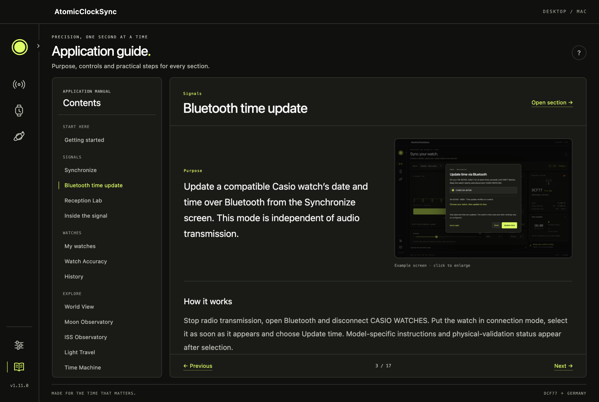
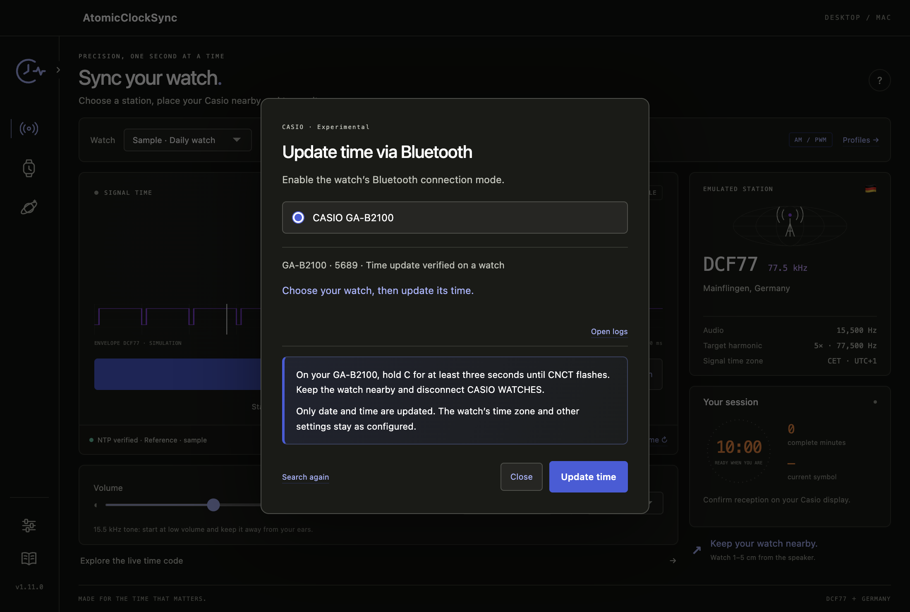
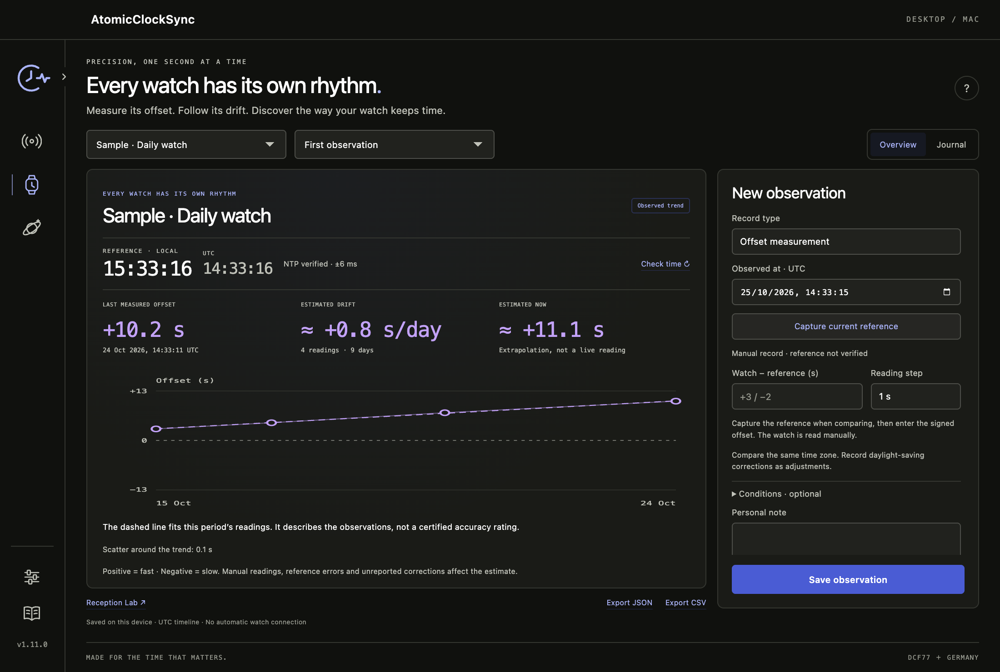
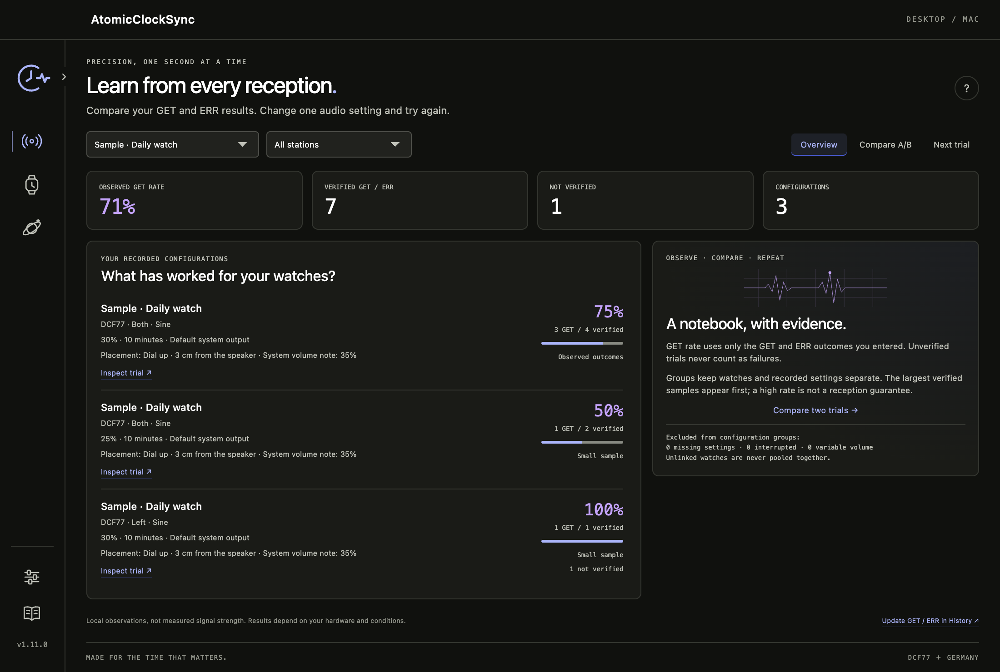
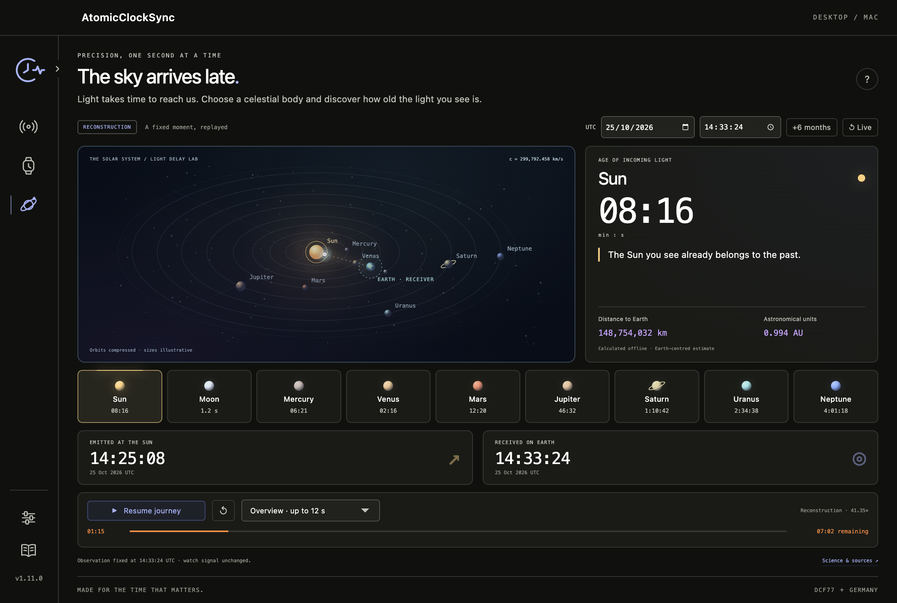
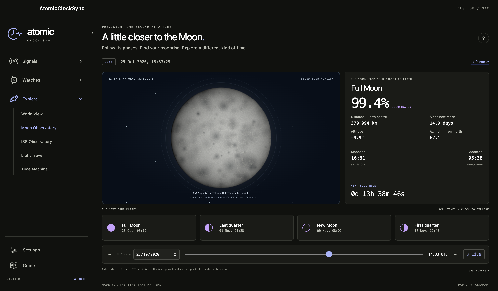
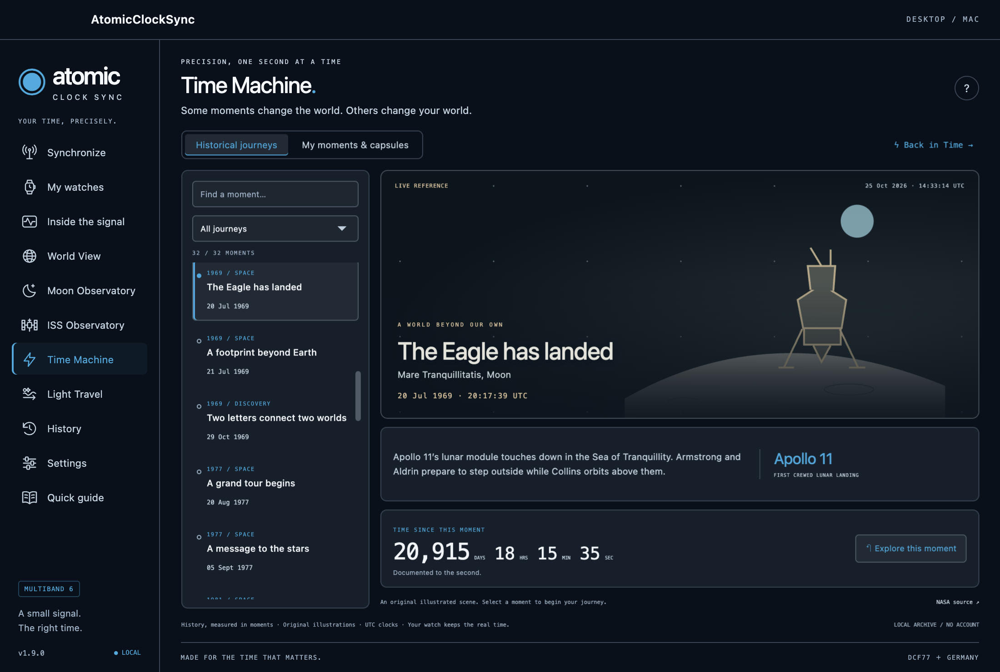

# AtomicClockSync

Sync compatible Casio watches through **Bluetooth** or simulated **Multiband 6 time signals** through your speakers. Built with **JavaScript and Electron** for macOS, Windows and Linux.


AtomicClockSync generates the time codes used by DCF77, MSF, WWVB, JJY and BPC. Choose a station, check the time, place your watch near a speaker or wired earphone, and start manual reception on the watch.

Choose English, Italian, French, German, Spanish or Japanese in **Settings → Language**. Language changes apply immediately and are saved on this device. Source files and documentation are in English. Read the [full user guide](docs/USAGE.en.md) for setup, troubleshooting and protocol details.

See [localization notes](docs/LOCALIZATION.md) for adding interface strings and running language checks.

## Features

- **Bluetooth time update (experimental):** one compact button in Synchronize supports explicit Casio family profiles, including GA-B2100 / 5689 and Mudmaster GWG-B1000 / 5713, with standard, analogue and dedicated time procedures. Only date/time is updated; Wear OS is excluded. GA-B2100C and GWG-B1000 time updates are physically confirmed on macOS; other models and SP/MIP firmware have validation limits. See [compatibility, setup and builds](docs/BLUETOOTH.md).
- **Watch Accuracy:** per-watch offset journal, segmented drift graphs, local/UTC references, correction events and JSON/CSV exports.
- **Reception Lab:** per-watch GET/ERR statistics, recorded-configuration groups, A/B comparison and preparation of a trial changing one audio setting.
- **Light Travel:** a cinematic offline Solar System, nine light sources, date-dependent travel times, departure/reception clocks and a controllable photon journey.
- **Moon Observatory:** offline lunar phases, illumination, distance, local moonrise/moonset, upcoming quarters and an independent timeline shared with your World View city.
- **Time Machine:** 96 sourced historical journeys, precision-aware elapsed counters, personal memories, countdowns and locally stored time capsules.
- **Back in Time:** a playful time-circuit dashboard inspired by Back to the Future, with five movie destinations, live elapsed-time counters and an animated 88 mph trip.
- **ISS Orbital Observatory:** live orbital estimates, offline prediction cache, local sighting passes, a sky plot and an educational time-dilation explorer.
- **World View:** an offline vector Earth with astronomical day/night, amber city lights, five stations, nominal coverage rings, 171,637 searchable cities and a seasonal timeline.

- **Five station protocols:** individual time-code encoders, markers and modulation envelopes.
- **NTP time checks:** PTB and Cloudflare references, with visible system-clock fallback when offline.
- **Watch profiles:** save the station, output, waveform, channel, volume, duration and placement notes for each watch.
- **Left, right or both audio channels:** includes a low-volume 440 Hz output test.
- **Complete trial history:** immutable snapshots of the settings used, live volume changes and manual GET/ERR outcomes, with pagination and settings restore.
- **Live signal view:** inspect the time code, current symbol, fields and parity checks.
- **Nine themes:** eight dark palettes and one light palette, saved independently of watch profiles.
- **Compact desktop interface:** a fixed 1100 × 740 window with separate views.
- **Illustrated application Guide:** 17 narrative chapters, practical examples and 84 real UI screenshots across six languages, with image zoom and contextual help. Settings and Guide stay pinned above the sidebar version.
- **Minimal sidebar:** a compact icon rail expands on hover or keyboard focus, overlaying the page without moving its content. Three animated groups keep navigation compact and remember the open theme.
- **Fluid navigation:** directional section reveals, animated headings and a moving sidebar indicator, with instant reduced-motion navigation.
- **Six interface languages:** offline translations of navigation, settings, notifications, astronomy, historical journeys and native menus, with a bundled Japanese font. Language changes preserve personal text and do not interrupt transmission.
- **Local data:** no account, cloud storage or telemetry.

## Application Guide



**Settings** and **Guide** are always available at the foot of the sidebar, including as icons in compact mode. Guide opens an offline manual with seventeen chapters covering every section, reception problems and data management. Each chapter combines its purpose, explanatory prose, a practical example and a real screenshot in the selected language; click the screenshot to enlarge it. Images use illustrative sample data. The **?** button opens the chapter for the current view, and **Open section** returns to the actual tool. Reading, changing chapters or closing an image preview does not interrupt audio.

## Supported stations

| Station | Location | Radio carrier | Generated audio tone | Example Casio home cities |
| --- | --- | --- | --- | --- |
| DCF77 | Mainflingen, Germany | 77.5 kHz | 15,500 Hz | ROM / BER / PAR |
| MSF | Anthorn, United Kingdom | 60 kHz | 20,000 Hz | LON |
| WWVB | Fort Collins, United States | 60 kHz | 20,000 Hz | NYC / CHI / DEN / LAX |
| JJY | Haganeyama, Fukuoka area, Japan | 60 kHz | 20,000 Hz | TYO |
| BPC | Shangqiu, Henan, China | 68.5 kHz | 13,700 Hz | BJS / HKG |

Station availability depends on the watch module and its home city. JJY currently supports the **60 kHz** station. BPC physical compatibility is experimental.

## Bluetooth time synchronization



Open **Synchronize → Bluetooth** with radio transmission stopped, disconnect
CASIO WATCHES and enable the watch’s connection mode. Select the detected watch
and choose **Update time**. The app checks internet time immediately before the
update, preserves the watch’s current time configuration and disconnects.
Bluetooth does not play an audio signal. The image uses a simulated detection;
it is an interface example, not evidence of reception.

| Watch | Connection action | Validation |
| --- | --- | --- |
| GA-B2100 / 5689 | Hold C at least 3 seconds, until CNCT flashes | Successful time update reported on GA-B2100C on macOS |
| GWG-B1000 / 5713 | Hold B at least 5 seconds, until CNCT | Successful time update and watch OK reported on macOS |
| GST-B1000D / 5748 | Hold B at least 2.5 seconds, until R; C about 0.5 seconds requests immediate time correction | Implemented; physical test pending |
| GW-9500 / 3553 | Use the radio mode | This model has no Bluetooth |

The registry has 129 model profiles with standard, analogue and dedicated-time
procedures. Other profiles remain experimental; some SP/MIP firmware is refused
when existing settings cannot be preserved completely. Wear OS is excluded.
“Time sent” reports a completed Bluetooth write: check the watch itself. If the
watch cannot report its UTC offset, the dialog asks you to confirm its current
offset, including summer time; it never assumes the computer’s time zone.

Packaged apps bundle the Bluetooth runtime. Targets are macOS, **Windows 11**
and Linux with **BlueZ 5.55 or later**, D-Bus access and a working BLE adapter.
Physical Bluetooth validation on Windows/Linux remains pending. See
[compatibility and build details](docs/BLUETOOTH.md), the
[model catalogue](docs/BLUETOOTH_MODELS.md) and the
[1.11.0 changelog](docs/RELEASE_NOTES.md).

## Watch Accuracy



Every watch has its own rhythm. Select a profile, capture the reference while comparing your watch and enter the signed offset in seconds: positive means fast, negative means slow. Local and UTC reference clocks are shown together; compare the same time zone. Backdated entries stay explicitly unverified. Reading step, optional wear/resting position, temperature and personal notes stay with each measurement.

The graph fits all readings within one observation period after at least two readings spanning 24 hours. It separates the last measured offset, estimated daily drift and a clearly labelled extrapolation. Corrections, confirmed radio synchronizations and maintenance start a new period without inventing a zero reading. Record automatic radio and daylight-saving corrections too. Forecasts never cross a correction and stop after seven days without a new reading; scatter around the fit appears with three or more readings.

Open **Track accuracy** from a profile or a linked GET trial. A GET trial pre-fills a correction event for your review; it does not create a measurement or save an event automatically. The journal supports editing, confirmed deletion and undo. Renaming a profile preserves identity; deleting it keeps its observations available as an archived watch. Export the selected watch as JSON or CSV. Everything stays local, and transmission keeps running while you explore. Manual readings and reference errors limit the estimate; it is not a certified accuracy measurement. See [measurement and data details](docs/WATCH_ACCURACY.md).

## Reception Lab



Open **Reception Lab** to learn from the trials already stored on this device. Filter by watch or station. The observed GET rate uses only outcomes explicitly entered as GET or ERR; unverified trials are counted separately. Configuration groups keep profile IDs and recorded settings/placement notes separate, with the largest verified samples first and a small-sample label below three verified outcomes. Unlinked watches are never pooled together.

**Compare A/B** highlights differences in two historical snapshots, including station, output, volume, waveform, channel, selected duration, manual advance and handwritten watch/placement/system-volume notes. It also shows actual transmission durations and explains missing data or changed conditions. Open either trial to update its result in History.

**Next trial** starts from a stable historical snapshot and changes one audio setting: app volume, channel, waveform or selected duration. Preparing applies the proposed audio settings and opens Synchronize without starting transmission or overwriting saved profile settings. Check the physical watch, placement and system volume against the reference. Unavailable outputs and removed profiles cannot silently fall back to a different configuration.

Legacy trials without snapshots, interrupted sessions and sessions with live volume changes are excluded from configuration groups and baseline selection; their manually entered outcomes remain in the overall rate. These are local observations, not signal-strength measurements or proof that a setting caused a result. The default output can resolve to different physical hardware, and the app cannot verify manual notes. The laboratory works offline in all six languages and nine themes.

## World View


Explore a vector Earth with a moving day/night terminator, gradual twilight and amber lights from 18,650 geographically grouped settlements. The map uses the app's time reference in **Live** mode. Scrub a UTC day, play one day per minute, or jump to an equinox or solstice. **Preview** time never changes the transmitted time.

Search **171,637 localities offline**, including local spellings and accented names. Select a city to see its local clock, sunrise, sunset, day length and distance to the selected station. City search loads its catalog in a dedicated worker on first focus; approximately 20 MB of data is kept separate from the much smaller map/light layer.

Explore all five station markers. **Coverage → Off / Selected / All stations** shows nominal Casio reception-range rings, not live signal measurements or reception guarantees. **Use station** explicitly selects a station for transmission and is unavailable during an active session. City lights illustrate settlement locations and are not measured light emissions.

Map: Natural Earth. Cities: GeoNames, CC BY 4.0. See [data sources, licenses and asset rebuild instructions](docs/THIRD_PARTY.md).

## ISS Orbital Observatory


Track the International Space Station over the day/night Earth, with a predicted ground track, geometric horizon footprint, altitude, orbital speed, illumination, inclination and orbit period. Select **ISS Observatory** in the sidebar, then explore four views:

- **Tracking:** online-updated orbital estimates, current country/ocean, position, distance and direction from your observing city, next potentially visible encounter and a short independent orbit preview.
- **Passes:** predicted encounters above 10° for up to 48 hours, filtered by potential naked-eye visibility, with local times, a countdown, maximum elevation and an interactive sky diagram. Preview a pass on the map.
- **Station:** a vector station schematic, mission facts and links to official crew/visiting-vehicle information and live video.
- **Time in Orbit:** an educational weak-field model of gravitational and velocity clock shifts, plus an introduction to ESA's ACES atomic clocks aboard the ISS. It does not receive ACES measurements.

The observer is your World View city; click its name to choose another location. Your coordinates stay local. Public HTTPS requests retrieve ISS data only while the observatory is visible. CelesTrak orbital elements are cached for at least two hours; Where the ISS at position reports are requested at most every ten seconds, with failure backoff and Retry-After handling. No API key is required.

Tracking uses SGP4 orbital calculations, **not onboard telemetry**. The interface distinguishes online prediction, offline cached prediction, position-only reports and unavailable/stale data. Offline propagation is limited to an explicitly displayed orbital age; elements older than 72 hours do not drive current tracking or new forecasts. Passes are clipped to that validity window. Estimated visibility requires a sunlit ISS and a dark local sky; weather, terrain, buildings and apparent brightness are not modeled.


See the [ISS user guide](docs/USAGE.en.md#iss-orbital-observatory) and [source/licensing notes](docs/THIRD_PARTY.md#iss-sources-and-orbit-software).

## Light Travel



**The sky arrives late.** Choose the Sun, Moon or one of seven planets in a star-filled orbital scene. The dashboard calculates how old its arriving light is, its distance, and the UTC departure/reflection and Earth reception times. Original vector planets, a glowing photon trail and an expanding arrival pulse bring the journey to life.

Follow a fixed observation at **1×, 10×, 100× or 1000×**, or choose an overview lasting at most twelve seconds. Pause, resume and change speed without losing progress. Select a UTC date from 1900 through 2100, jump six months or return to **Live** to explore changing distances. Leaving the section or hiding the window pauses playback.

Astronomy Engine calculates the source's earlier position relative to Earth at reception, entirely offline. Distances use body centres; the diagram compresses orbits and illustrates planet sizes. For reflected light, the displayed journey begins at the Moon or planet and excludes the earlier Sun-to-object leg. This is an educational light-time reconstruction, not a visibility forecast. It supports all six languages, nine themes and reduced motion, independently of watch transmission.

## Moon Observatory



Explore the Moon from your World View city, with calculated illumination, distance from Earth's centre, lunar age, altitude, azimuth and local moonrise/moonset. A full-Moon countdown and the next four phase events use the same observing city and time zone. Click a phase, select a UTC date or scrub the time of day to preview independently; **Live** restores the app's time reference.

Calculations run offline using Astronomy Engine. The original procedural lunar terrain and phase orientation are illustrative, rather than a photographic map or telescope view. Rise/set estimates assume a level horizon and standard atmospheric conditions. Dates from 1900 through 2100 are supported.

## Time Machine



Open **Time Machine → Historical journeys** to explore 96 moments from the Gregorian calendar reform in 1582 to optical-clock research in 2024. Filter space exploration, astronomy, time science, discovery/invention, or clocks/calendars; search titles, places, mission names and stories. Each moment has an original illustrated scene and an external primary-source reference. Dates without a documented time show only UTC calendar days; approximate and minute-resolution records do not invent elapsed seconds.

**My moments & capsules** stores up to 100 local memories and countdowns. Create a time capsule with a future UTC opening date: its message remains hidden in the interface until that date. Capsules are stored locally without encryption; this is a keepsake feature, not secure storage. Memories can be edited, and deletion requires an explicit confirmation. **Back in Time** opens the existing film dashboard from the same section. All previews leave NTP, transmitted time and watch settings unchanged.

## Back in Time


Open **Time Machine → Back in Time** for a playful detour through Hill Valley. A brushed-metal dashboard recreates the red, green and amber time-circuit displays using original SVG instruments, alongside a flux capacitor and an **88 MPH** jump button.

Choose the Old West (2 September 1885), the first 1955 destination (5 November), the clock-tower lightning strike (12 November 1955), Einstein's return at Twin Pines Mall (26 October 1985), or the arrival in the future (21 October 2015). Every card shows elapsed days; the selected event has a live days/hours/minutes/seconds counter.

All circuits use **Hill Valley / Pacific time**. Jumping animates a cinematic preview of the selected destination, records your departure and celebrates with **“GRANDE GIOVE!!”**. **Return to the present** restores the live display. The elapsed counters always compare film events with the actual app time reference. The feature works offline, respects reduced-motion preferences and never changes the app clock, watch settings or transmitted signal.

## How audio synchronization works

A normal audio output cannot directly generate the longwave radio carrier expected by the watch. The app produces a lower-frequency audio tone and relies on harmonics and electromagnetic coupling from the speaker or earphone electronics.

**Reception depends on the output hardware, placement and interference.** A valid generated time code does not guarantee reception. The app cannot read the watch display or automatically confirm reception; GET/ERR outcomes are entered by the user.

## Downloads and platform status

Source version: **1.11.0**. Its release packages are not published yet. [GitHub Releases](https://github.com/Gladiak/atomicClockSync/releases/latest) contains the previous published version. The 1.11.0 build targets are:

| Package | Contents | Status |
| --- | --- | --- |
| `AtomicClockSync-1.11.0-arm64-mac.zip` | macOS app for Apple Silicon | Build on macOS; local ad-hoc signature, not notarized |
| `AtomicClockSync-1.11.0-windows-x64-portable.exe` | Windows 11 x64 portable executable | Build natively on Windows with bundled BLE worker; physical validation pending |
| `AtomicClockSync-1.11.0-linux-x86_64.AppImage` | Portable Linux x64 application | Build on Ubuntu 22.04; physical Bluetooth validation pending |
| `AtomicClockSync-1.11.0-linux-amd64.deb` | Installable package for Debian/Ubuntu/Mint x64 | Same Linux application with bundled BLE worker |
| `AtomicClockSync-1.11.0-linux-x86_64.rpm` | Installable package for Fedora/openSUSE x64 | Same Linux application with bundled BLE worker |
| `SHA256SUMS.txt` | SHA-256 hashes | Integrity verification |

Prebuilt apps include Electron and the Bluetooth/Python runtime; **Node.js and Python are not required to use them**. On macOS, extract the app and open it or copy it to Applications. On Windows, extract and run the portable executable. Portable means installation-free; profiles and history still live in the user data directory.

On Linux x64, choose the AppImage for portable use, the DEB on Debian-based distributions, or the RPM on Fedora/openSUSE. The names `x86_64` and `amd64` both mean 64-bit Intel/AMD PCs. These builds do not target ARM64. From your download directory:

```sh
chmod +x 'AtomicClockSync-1.11.0-linux-x86_64.AppImage'
./'AtomicClockSync-1.11.0-linux-x86_64.AppImage'
# Alternatively, on Debian/Ubuntu/Mint:
sudo apt install './AtomicClockSync-1.11.0-linux-amd64.deb'
# Alternatively, on Fedora:
sudo dnf install './AtomicClockSync-1.11.0-linux-x86_64.rpm'
# Or on openSUSE:
sudo zypper install './AtomicClockSync-1.11.0-linux-x86_64.rpm'
```

Linux validation uses Ubuntu 22.04 x64 in Docker with a virtual display, muted audio and `--no-sandbox` for the container-only test. Normal launch commands retain Chromium's sandbox. Audio output and physical watch reception still need a real Linux desktop/hardware test. Release binaries are excluded from Git and are intended for GitHub Releases. Each platform package is distributed individually.

## Quick start

1. Choose a station compatible with the home city set on your watch. For example, use DCF77 with ROM, BER or PAR on a compatible Casio module.
2. Click **Check time** to obtain an NTP reference, or use the clearly marked system-clock fallback.
3. Place the watch antenna, often at the 12 o’clock side, about **1–5 cm** from a built-in speaker or wired earphone.
4. Select the output channel. Start at low app volume and moderate system volume. Keep the high-frequency tone away from your ears.
5. Start manual reception on the watch, then click **Start transmission**. Keep the watch still for several complete minutes.
6. Check the watch display. Click **My Casio received** after successful reception, or record GET/ERR later in **History → Details**.

Sessions contain 5, 10 or 15 complete minutes, with an initial alignment interval. For difficult DCF77 reception, try **Settings → Audio profile → DCF77 · full pauses (experimental)**. The [user guide](docs/USAGE.en.md#gw-6900-l3-followed-by-err) explains L3 and ERR troubleshooting.

## Themes

Lime Green · Cyan Blue · Fuchsia Pink · Ruby Red · Champagne Gold · Seafoam Teal · Amethyst Purple · Lava Orange · Atlantic Blue

Choose a palette in **Settings → Theme**. The choice persists across launches and can change during transmission without changing audio settings.


## Run from source

Requires **Node.js 22.12 or later** and npm. From a local checkout:

```sh
git clone https://github.com/Gladiak/atomicClockSync.git
cd atomicClockSync
npm ci
node node_modules/electron/install.js
npm start
```

The explicit runtime download is needed for the Electron version used here. No web server is required.
For Bluetooth development, also prepare the project-local Python environment described in [Bluetooth setup](docs/BLUETOOTH.md). Packaged applications include that runtime.

## Tests and packaging

```sh
npm test                 # Protocol, PCM, stereo routing, profile, migration and NTP tests
npm run test:desktop     # Real Electron and AudioWorklet; audio muted
npm run test:navigation  # App identity, motion, rapid clicks, focus and live audio isolation
npm run test:guide         # All manual prose/images in six languages, footer links and preview audio isolation
npm run capture:guide      # Regenerate the manual screenshots from a temporary sample profile
npm run test:accuracy      # Offset journal, segmented drift, GET links, exports, languages and themes
npm run test:reception-lab # Statistics, A/B comparison, preparation, locales and audio isolation
npm run test:languages   # Six locales, all views, Japanese glyphs, persistence and live audio
npm run test:world       # Offline atlas, city worker, timeline and audio isolation
npm run test:iss         # ISS states, passes, sky plot, themes and audio isolation
npm run test:light-travel # Nine sources, fixed journeys, UTC previews, languages and themes
npm run test:observatory  # Moon phases, historical journeys, capsules, themes and audio isolation
npm run test:back-in-time # Movie circuits, time travel, layout and audio isolation
npm run build:iss        # Rebuild the bundled SGP4 library
npm run build:world      # Rebuild the bundled cartography/astronomy dependencies
npm run test:bluetooth   # Bluetooth dialog, cancellation and immediate watch selection; hardware substituted
npm run build:bluetooth  # Prepare the native worker on the target OS/architecture before packaging
npm run pack             # Unpacked application
npm run dist             # macOS ZIP for the host architecture
npm run dist:win         # Windows x64 portable, with the configured native NSIS toolset
npm run dist:linux       # Linux x64 AppImage + DEB + RPM; run on Linux
npm run dist:linux:docker # Same packages from macOS/Windows/Linux with Docker
npm run checksums        # Hash current-version platform packages; requires Python 3
npm run checksums -- --github # Use GitHub download filenames in the published manifest
```

The Docker build uses a pinned official Electron Builder image, reads the checkout without changing it, installs Linux dependencies in the temporary container and writes only to `release/`. Host `node_modules` stays separate. `npm run checksums` generates `SHA256SUMS.txt` for the current-version individual packages available in `release/`; use `-- --github` before uploading that manifest because GitHub replaces filename spaces with dots. Electron Builder additionally supports Snap, Flatpak, Pacman and archive targets; AppImage, DEB and RPM are configured here. The DEB/RPM payloads match the application tested on Ubuntu; installation and desktop integration on other distributions remain untested.

The unit tests include independent decoding of generated PCM across the autumn DST transition, movie-date duration calculations, translation/interpolation coverage and light-time comparisons against independent JPL Horizons reference values. Bluetooth adds protocol/worker tests and desktop checks for immediate selection, exclusive controls, cancellation and ambiguous outcomes. The desktop suites check six languages, nine themes, text contrast, persistence, fixed-window layout, profiles, history, channel selection, offline fallback and interruption handling. Language checks include long translations, Japanese glyphs, historical journeys, native menus, unsaved personal text and uninterrupted muted transmission. Tests use temporary profiles and do not overwrite user data.

The desktop suite writes screenshots to `artifacts/`. Physical reception on a watch requires a separate hardware test. A user has reported successful DCF77 reception on a GW-6900 using built-in Mac speakers; this is not a general hardware compatibility guarantee.

See [the release notes](docs/RELEASE_NOTES.md) for the package inventory and validation status.

## Data and privacy

Preferences, themes, watch profiles and trial history are stored locally using Electron `localStorage`. On macOS, the app data directory is:

```text
~/Library/Application Support/Atomic Clock Sync/
```

The storage directory keeps its original name after the app is renamed to AtomicClockSync, preserving existing local data.

Close the app before backing up that entire directory. Replacing the app or cleaning the build directory does not delete it.

World View remembers its selected city, coverage mode and twilight-line preference separately from watch profiles. City queries stay offline.

ISS source data are cached separately in `iss-cache.json` inside the same app data directory. Opening ISS Observatory contacts CelesTrak and Where the ISS at over HTTPS, with no city coordinates sent to either service.

NTP checks contact `ptbtime1.ptb.de`, `ptbtime2.ptb.de` and `time.cloudflare.com`. They adjust the time reference inside the app, not the operating system clock. NTP uses UDP/123 without NTS authentication. Offline use is available with the system clock.

## Project structure

```text
electron/   Native window, isolated preload, lifecycle and NTP
src/        Interface, themes, station encoders, AudioWorklet and trial data
assets/     Application artwork
scripts/    Icon generation, desktop validation and release bundling
test/       Unit tests and reference vectors
docs/       User guides, screenshots and release notes
```

## Credits and license

An independent implementation inspired by [Clock Wave](https://cw.rzapps.com/). Protocol references include [PTB](https://www.ptb.de/cms/en/ptb/fachabteilungen/abt4/fb-44/ag-442/dissemination-of-legal-time/dcf77/dcf77-time-code.html), [NICT](https://jjy.nict.go.jp/jjy/trans/index-e.html), [NIST](https://www.nist.gov/pml/time-and-frequency-division/time-distribution/radio-station-wwvb/wwvb-time-code-format) and [Casio module manuals](https://support.casio.com/en/manual/manuallist.php?cid=009). Additional technical sources are listed in the user guide.

Not affiliated with Casio, Clock Wave or the time-signal stations.

Released under the [MIT License](LICENSE).
